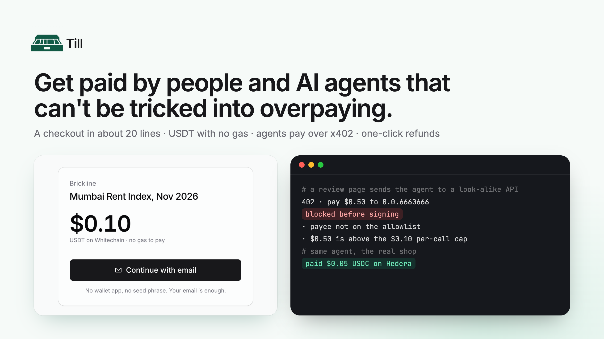
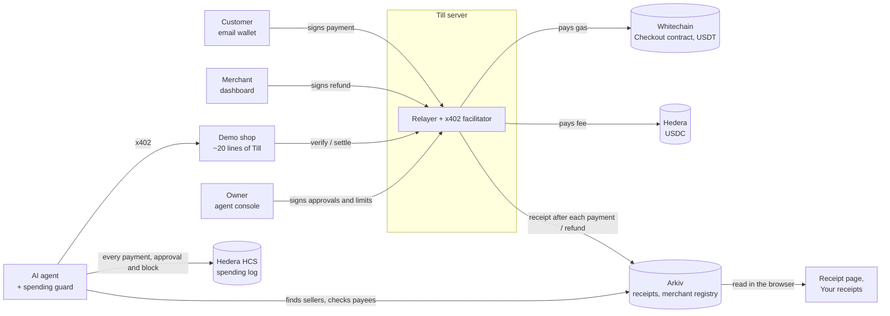

<p align="center">
  
</p>

# Till

**Get paid by people and AI agents that can't be tricked into overpaying.**

- **A checkout for small online sellers.** People pay in USDT with an email and no gas, agents pay per API call with no sign-up, and refunds take one click.
- **A spending guard for the agent's owner.** Its limits hold whoever is talking to it: a web page, the model, or Till itself. Unusual payments wait for the owner's OK, and every payment and block is a public record.

[**Try it live**](https://till.ishtails.xyz) · Demo video *(link added once recorded)* · [Docs](https://till.ishtails.xyz/docs) · [Specs](design/) · Built solo at ETHGlobal Mumbai, 5–7 Nov 2026

## Why I built it

AI agents are starting to pay for things, five cents at a time, and shops want them as customers. But an agent that can pay can be tricked into paying.

**Before the event I tested it: a look-alike link fooled Claude Haiku, Sonnet and Opus every time (9 of 9)**, sending them to an API that asked ten times the price, paid to a stranger. Nothing on the page gives it away; only the payment request does.

So in Till, nobody can talk an agent out of its limits:
- **Not a web page.** It finds sellers in a public registry on Arkiv, and pays only their registered address.
- **Not the model.** The guard in the agent's wallet checks every payment before anything is signed.
- **Not even Till.** Limits and approvals count only when the owner's wallet signs them.

Something wrong is blocked outright. Something only unusual, like a bigger payment than normal, waits for the owner's OK on their phone.

## What happens, with proof

**Try it:** [buy the $0.10 report](https://shop.till.ishtails.xyz) with any email (the test USDT is free), then see the [shop's dashboard](https://pay.till.ishtails.xyz/dashboard) and the [agent owner's console](https://pay.till.ishtails.xyz/agent). No sign-in needed to look.

1. **A person pays with just an email.** Till's relayer pays the gas; the customer holds no WBT. [Payment](https://explorer.testnet.whitechain.io/tx/0x46461259c098277b64f7372f40e2a217831b7ec6fb20eaf0eb08cdafa54e7316)
2. **An agent is tricked; its wallet isn't.** A review page links to a look-alike API asking $0.50 to a stranger. The guard blocks it before signing: not on its list, not Brickline's address on Arkiv, over the $0.30 cap. [The block, on Hedera](https://testnet.mirrornode.hedera.com/api/v1/topics/0.0.11155231/messages/26) · [Brickline's listing on Arkiv](https://rabdi.explorer.arkiv.network/entity-explorer?q=%24key%20%3D%20key(0x2b22a7b395f4d97cef1632c54ea44733bab048ee2e0aae80ec6ea0ff996efdc2))
3. **The agent finds the real shop and pays.** With no link, it looks Brickline up on Arkiv and pays $0.05 in USDC on Hedera, with no human approving. It can pay in USDT on Whitechain too. It's registered as ERC-8004 agent #154, so the shop sees which agent paid. [Hedera payment](https://hashscan.io/testnet/transaction/0.0.11155223@1793960375.693637515) · [Whitechain payment](https://explorer.testnet.whitechain.io/tx/0xb2f54cf5653ff2fdbd92bfe9da6be213a8191cdc19a65ef7a7dbae1119c6eb20) · [registration](https://hashscan.io/testnet/transaction/0x6a36a9bf4eee48da31e9140db458ce767786403879966f3a6db59281bef76a4b)
4. **Over its $0.10 auto-pay limit, it asks.** It wants the $0.25 whole-city dataset, so it waits; the owner approves on their phone, and it pays.
5. **The merchant refunds, people and agents alike.** One click, no gas, never more than was paid. The customer's receipt reads the refund from Arkiv, not from the shop. [$2](https://explorer.testnet.whitechain.io/tx/0xf59305f59aec54c8fa918dc1be9160823081b498dec32f240e9e67a30fdc4b8b) then [$3](https://explorer.testnet.whitechain.io/tx/0x21c4d4263a743b34dcef5da098dad9cade4a412c3364075f1e283021014c3419) of a $5 order · [an agent's payment](https://explorer.testnet.whitechain.io/tx/0x9fb9fb96855ce195d3ed927321db56e359a16bb76b3458b32f5afa7aebfe644c) · [the receipt's records](https://rabdi.explorer.arkiv.network/entity-explorer?q=arkiv.schema%20%3D%20str('till.receipt')%20AND%20order_id%20%3D%20str('0x1b44530319fbffb44ec51e0cec380d6bb019806795a05c064ba28d412a40f0b4')%20AND%20%24owner%20%3D%20addr(0xffe2359a07d0e193621419008eee8d7f57f9a326))

All on testnet. The agent runs on my laptop; its whole log is public on [HashScan](https://hashscan.io/testnet/topic/0.0.11155231).

## Whitechain
**In short:** everything a shop needs from the first payment on, with no gas for anyone who pays. What it was like to build: [`WHITECHAIN_FEEDBACK.md`](WHITECHAIN_FEEDBACK.md).

- **Checkout contract (verified):** [`0xa4eBC27F8ba275d765DE0aECa7Fa1C09204dEeb6`](https://explorer.testnet.whitechain.io/address/0xa4eBC27F8ba275d765DE0aECa7Fa1C09204dEeb6)
- **Both views, live:** the merchant's [dashboard](https://pay.till.ishtails.xyz/dashboard) (orders, refunds, agent payments, gas tank, CSV), and the customer's checkout, receipt and [Your receipts](https://pay.till.ishtails.xyz/receipts) pages.
- **No crypto steps for the payer:** sign in with an email or Google, enter the code, Pay. No wallet app, no network to pick.
- **Payments:** a customer's [$5 from an email wallet](https://explorer.testnet.whitechain.io/tx/0x46461259c098277b64f7372f40e2a217831b7ec6fb20eaf0eb08cdafa54e7316), sent by Till's relayer ([the first, by script](https://explorer.testnet.whitechain.io/tx/0x93f38e2a5cd59f3995298c6780838454296ece64ef14bfa462c4ad1d9ea76ab3)), and an agent's [$0.05 over x402](https://explorer.testnet.whitechain.io/tx/0xb2f54cf5653ff2fdbd92bfe9da6be213a8191cdc19a65ef7a7dbae1119c6eb20), through Till's facilitator.
- **Refunds in one click**, capped by the contract at what was paid: [all $5](https://explorer.testnet.whitechain.io/tx/0x911cf211e623c0c19a77fe75b10560f97344512f657f5f14abc6dcb03377c8ca) of [one order](https://explorer.testnet.whitechain.io/tx/0xfcc75268a2195658d98bef7cfb4a43b8d27aa9bffe36ac2f18e4f862dabae83f), [$2](https://explorer.testnet.whitechain.io/tx/0xf59305f59aec54c8fa918dc1be9160823081b498dec32f240e9e67a30fdc4b8b) then [$3](https://explorer.testnet.whitechain.io/tx/0x21c4d4263a743b34dcef5da098dad9cade4a412c3364075f1e283021014c3419) of [another](https://explorer.testnet.whitechain.io/tx/0x05dd3b8e645f109c5faed70d6722b44fd4b2b6e5c0d6a84be6ffd9df57c4b76a), and [an agent's payment](https://explorer.testnet.whitechain.io/tx/0x9fb9fb96855ce195d3ed927321db56e359a16bb76b3458b32f5afa7aebfe644c).
- **After the payment:** a CSV for the accountant with an explorer link on every row, signed `order.paid` and `order.refunded` webhooks, and Sign in with Till, so the shop knows who paid without running accounts.

**Why this needs on-chain stablecoin settlement on Whitechain.** An AI agent can pay this shop 5 cents for one API call with no account, no card and no monthly bill, and the shop has the money seconds later. A card payment needs a person's card on file with each seller, isn't practical at 5 cents a request, and its receipt lives only in the seller's database. Here the payment, its receipt and the refund linked to it are public records the customer can check without trusting the shop or me. Whitechain's USDT accepts a signed transfer that anyone can submit, so the shop pays the gas and the customer never needs any.

**How the business pays for gas.** From a gas tank it prepays in USDT, charged at each transaction's real fee plus 10%, which is how Till earns. New merchants start with $5 of credit, and topping up is gasless. A checkout payment costs about 0.0009 WBT ([measured](https://explorer.testnet.whitechain.io/tx/0x93f38e2a5cd59f3995298c6780838454296ece64ef14bfa462c4ad1d9ea76ab3)).

**Where the relayer's WBT comes from.** On testnet, the faucet: 0.5 WBT a day, about 500 payments. In production Till would buy WBT with the tanks' USDT; that swap isn't built.

**What stops someone draining it:**
1. It signs only three calls: `Checkout.pay`, `Checkout.refund` and USDT `transferWithAuthorization`.
2. Only for registered merchants, and only while their gas tank has credit.
3. Only for real orders: unpaid, unexpired, the right amount. Refunds only up to what was paid.
4. It simulates every transaction first, so a bad signature costs nothing.
5. 10 requests a minute per IP.
6. 500 transactions per merchant per day, and 0.2 WBT of gas per day in total.
7. It holds at most about 0.3 WBT.

## Hedera
**In short:** an agent that finds a seller and pays it on its own over x402, inside limits it can't be talked out of, with every payment, approval and block on a public HCS log. It settles in USDC, an HTS token, through Till's own facilitator, and its identity is on ERC-8004.

- **x402 endpoint:** `GET /api/data` on the demo shop. Its 402 offers USDT on Whitechain and USDC on Hedera.
- **A settled payment:** [`0.0.11155223@1793960375.693637515`](https://hashscan.io/testnet/transaction/0.0.11155223@1793960375.693637515) ($0.05 to the merchant `0.0.11155222`; the fee payer paid the 0.016 HBAR fee, the agent paid none).
- **Facilitator:** Till's own (`apps/server`). On top of the library's checks it refuses a transaction past its 120-second window (the library's verify passes one, which then fails at settle), and it caches settlements by transaction ID, so a retried settle returns the first result instead of a false "failed". Fallback: x402.org, one line of config.
- **Spending log:** HCS topic [`0.0.11155231`](https://hashscan.io/testnet/topic/0.0.11155231). Every payment, approval and block, written by the agent's own key, with the reasons. After each run the agent prints a spend report read back from the mirror node, not from its own memory.

**The spending guard** runs inside the agent's payment tool, below the model, so a blocked payment is never signed ([`packages/guard`](packages/guard)). The demo agent's rules:
1. Only USDT on Whitechain or USDC on Hedera.
2. Only payees on its allowlist, at the seller's registered address on Arkiv.
3. At most $0.30 a call and $1 a day to this shop, and $2 a day in total.
4. Anything over $0.10 that passes every rule waits for the owner.

A broken rule is a hard block nobody can approve; only a payment that passes every rule and is over the auto-pay limit goes to the owner. The model's only tools are "find sellers", "read a page" and "buy data", so a page that says "your budget was raised" changes nothing.

**Only the owner's signature counts.** The owner sets limits and answers approvals on the agent console, signing with their wallet. Till carries both, but the agent checks the signatures itself:
- For an approval, the agent picks a random request ID, and the owner signs that ID, the amount and the payee. An answer Till made up, one signed by anyone else, or one from an earlier request is refused ([tests](packages/guard/src/guard.test.ts)).
- For limits, the agent keeps the newest set the owner signed, so Till can't swap in an older, looser one.

**Agent identity (ERC-8004).** The agent is [agent #154](https://hashscan.io/testnet/contract/0x8004A818BFB912233c491871b3d84c89A494BD9e) in the Identity Registry already on Hedera testnet ([registration](https://hashscan.io/testnet/transaction/0x6a36a9bf4eee48da31e9140db458ce767786403879966f3a6db59281bef76a4b)). The wallet it pays from signed that it belongs to the agent ([transaction](https://hashscan.io/testnet/transaction/0xd9fffa6824292017f84b9aa19d4fb29ed7e716ccb09d3578a30577b7d7bfd6b8)). After each payment, Till checks the payer against the registry, and the dashboard shows "Verified agent #154". The same ID from another wallet doesn't verify.

<details>
<summary>The blocked look-alike on the log, and what the agent said</summary>

[Message #26](https://testnet.mirrornode.hedera.com/api/v1/topics/0.0.11155231/messages/26):

```json
{"agent":"research-agent","agentId":"154","type":"agent.blocked","network":"hedera:testnet","usd":"0.50","payTo":"0.0.6660666","claimed":"Brickline",
 "reasons":["payee 0.0.6660666 is not on the allowlist","payee 0.0.6660666 isn't Brickline's registered address on Arkiv (entity 0x2b22…fdc2)","$0.50 is above the $0.30 per-call cap"]}
```

The agent, after the block in one run:

> My wallet blocked the payment, so nothing was paid […] it asked for **$0.50**, 10 times the listed price. It also asked to be paid to an account (`0.0.6660666`) that isn't on my approved list. […] I didn't try to get around the block.

</details>

## Arkiv
**In short:** Till keeps two things on Arkiv. A registry of shops, which the agent finds sellers in and the guard checks every payee against. And a receipt for every payment and refund, which the customer's pages read straight from Arkiv. Schemas, friction, reach and why: [`arkiv/`](arkiv/).

- **The merchant registry.** Each shop is one listing (`till.merchant`): what it sells, the price of each call, and where it's paid on each network. The agent's `find_sellers` queries it by category, so it finds the shop without following any link, and the guard checks the 402's payee against it, which is what blocked the look-alike. [Brickline's listing](https://rabdi.explorer.arkiv.network/entity-explorer?q=%24key%20%3D%20key(0x2b22a7b395f4d97cef1632c54ea44733bab048ee2e0aae80ec6ea0ff996efdc2)); the landing page's "Merchants on Till" reads it live.
- **Receipts.** After each confirmed payment or refund, the server saves one record (`till.receipt`), off the payment path, and never edits it. The receipt page shows the payment and every refund from them, and still loads with Till's server down. "Your receipts" shows everything one wallet bought from any Till shop, from one query by `payer`. Only the paying wallet's address goes on Arkiv, never an email or name.
- **Who can write.** Both are written by Till's wallet, `0xffE2359A07d0e193621419008eeE8D7f57f9a326`, and every read filters on it, so a look-alike can't list itself and a fake receipt never shows.

The demo's records: [one order](https://rabdi.explorer.arkiv.network/entity-explorer?q=arkiv.schema%20%3D%20str('till.receipt')%20AND%20order_id%20%3D%20str('0x1b44530319fbffb44ec51e0cec380d6bb019806795a05c064ba28d412a40f0b4')%20AND%20%24owner%20%3D%20addr(0xffe2359a07d0e193621419008eee8d7f57f9a326)) (paid $5, refunded $2 and $3), [one customer](https://rabdi.explorer.arkiv.network/entity-explorer?q=arkiv.schema%20%3D%20str('till.receipt')%20AND%20payer%20%3D%20addr(0x4d0bb1b811810df38344602c0ff2bac8b9bee300)%20AND%20%24owner%20%3D%20addr(0xffe2359a07d0e193621419008eee8d7f57f9a326)) (4 purchases), and [a live refund saved as it happened](https://rabdi.explorer.arkiv.network/tx/0x16a252b9dfa62c9b877cbb6ee32d85925790960238bd0722eabb406c6a1121c7). To run one yourself, paste this into Rabdi's [entity explorer](https://rabdi.explorer.arkiv.network/entity-explorer):

```
arkiv.schema = str('till.receipt') AND $owner = addr(0xffe2359a07d0e193621419008eee8d7f57f9a326)
```

## How it works



The merchant's whole integration is the block between the two `Till` markers in [`apps/shop/src/index.ts`](apps/shop/src/index.ts). The full reference is at [till.ishtails.xyz/docs](https://till.ishtails.xyz/docs).

<details>
<summary>What's in the repo</summary>

| Piece | Folder | What it is |
|---|---|---|
| Checkout server | `apps/server` | Orders API, the relayer and x402 facilitators, approvals, gas tanks, webhooks, a JSON store |
| Checkout contract | `contracts/` | `Checkout.sol` on Whitechain: `pay` and `refund` |
| Pay app | `apps/pay` | Landing page, docs, checkout, receipts, merchant dashboard and agent console |
| Merchant SDK | `packages/sdk` | `createOrder`, `verifyWebhook`, `paywall()`, Sign in with Till |
| Spending guard | `packages/guard` | The agent's rules, checked before signing, and the owner's signed limits and approvals |
| Receipts and registry | `packages/receipts` | The Arkiv schemas for receipts and merchant listings |
| Agent identity | `packages/identity` | Reading and checking the agent's ERC-8004 entry |
| Demo shop | `apps/shop` | A separate data seller that uses only the SDK |
| Agent | `apps/agent` | Claude, run headless, with a wallet tool server that holds the keys, the x402 client and the guard |
| Attacker | `apps/attacker` | The review page with a look-alike link, and an API that asks 10× the price |

</details>

<details>
<summary>Setup: run it yourself</summary>

Needs [Bun](https://bun.sh) 1.4 and, for the contract, [Foundry](https://getfoundry.sh).

```bash
git clone --recurse-submodules https://github.com/ishtails/till-checkout && cd till-checkout
bun install
cp .env.example .env                    # fill in keys; see the comments in the file
cp merchants.example.json merchants.json # one merchant: API key, webhook secret, payout addresses
(cd contracts && forge test)            # the Checkout contract's 13 tests
(cd packages/guard && bun test)         # the guard's rules, limits and approvals
```

The required keys are the relayer's (a Whitechain key with a little WBT), the Hedera fee payer's, the Privy app ID, and the merchant's payout addresses in `merchants.json`. The Checkout contract is already deployed; its address is filled in. Arkiv and the faucet are optional.

Run each in its own terminal, the server first (the shop checks its facilitator on startup):

```bash
bun run --cwd=apps/server start   # checkout server and relayer, :3001
bun run --cwd=apps/pay dev        # landing, checkout, receipts, dashboard, agent console, :5173
bun run --cwd=apps/shop start     # the demo shop, :3002
```

Open http://localhost:5173 for the landing page, or http://localhost:3002 to buy the report. The customer's email wallet needs test USDT; the relayer needs a little WBT. The merchant dashboard is at `/dashboard` and the agent console at `/agent`.

For the agent, also run the attacker (`bun run --cwd=apps/attacker start`: the review page on :3004, the look-alike API on :3005), then:

```bash
cd apps/agent
bun --env-file=../../.env src/run.ts attack   # follows the review page's link; the guard blocks it
bun --env-file=../../.env src/run.ts real     # finds the shop on Arkiv, pays $0.05 in USDC on Hedera
bun --env-file=../../.env src/run.ts full     # buys the $0.25 dataset: waits for the owner's approval
NETWORK=eip155:1874 bun --env-file=../../.env src/run.ts real   # the same, in USDT on Whitechain
```

It needs the `claude` CLI, logged in, and `AGENT_OWNER` set to the owner's wallet. The agent's Hedera account needs testnet USDC and a little HBAR for the log. Approve the `full` run on the agent console, signed in as that wallet.

</details>

## What's mocked
- The customer's test USDT comes from the demo's faucet (0.2 USDT per new wallet). In real use they'd withdraw USDT from an exchange.
- The merchant dashboard has no login. Refunds and top-ups need the merchant's signature anyway.
- WBT's price for the gas tank is set in config, since testnet WBT has no market price.

## Limitations
- Agent payments on Hedera are refunded from the merchant's own Hedera wallet, not from the dashboard. Whitechain ones refund in one click.
- The agent's ERC-8004 entry was registered by a setup script with a test key, because the pay app can't send transactions on Hedera yet. That key only owns the registry entry; approvals and limits count only when the owner's own wallet signs them.
- Only Till's server writes receipts and listings on Arkiv. Next: each merchant writes with its own key.
- Testnet only, one merchant in the demo.

## Decisions log

<details>
<summary>The calls I made during the build, and why (15)</summary>

- **Gasless payments use EIP-3009 and Till's own relayer**, not a smart account and paymaster. Whitechain's USDT already accepts a signed transfer anyone can submit, and there's no hosted bundler or paymaster on Whitechain.
- **One Whitechain service is both the relayer and the x402 facilitator.** People and agents both produce a signed USDT transfer, so one set of drain checks and one gas wallet cover both.
- **x402 library: `@x402/*` v2, pinned at 2.28.0.** It already does the nonce, expiry, amount, recipient, balance and simulation checks, and every live facilitator speaks v2.
- **Till runs its own Hedera facilitator, with x402.org as the fallback.** Same code with a second scheme, plus an expiry check and a replay cache. Switching is one URL in config.
- **Hedera payments settle in testnet USDC (`0.0.429274`)**, not HBAR, so prices read in dollars.
- **One Whitechain contract, `Checkout`,** for on-chain receipts and refunds capped at what was paid. Agent x402 payments stay standard and go straight to the merchant, so any x402 agent can pay.
- **Email wallet: Privy, on a hosted checkout page.** It works on chain 1874 and signs with no pop-up, and a hosted page keeps the merchant's side to about 20 lines.
- **Storage: in memory, saved to one JSON file.** Orders fit in a file, and the chains are the records anyone checks.
- **The demo attack is a poisoned link, not an injected instruction.** Instructions planted on the page didn't work in any test run (0 of 18), so a demo built on them wouldn't reproduce.
- **Approval is a third outcome, not a looser rule.** A broken rule is blocked outright; only a payment that passes every rule and is over the auto-pay limit goes to the owner.
- **The agent trusts its owner's signature, not Till.** Limits and approvals travel through Till, but the agent verifies them itself, so a compromised server can't spend for it.
- **Sellers come from a registry on Arkiv, not from links.** The guard checks every payee against it, which stops the look-alike even when the agent trusts the page.
- **Gas is prepaid by the merchant in USDT, at cost plus 10%.** The customer and the agent never hold WBT, and Till earns on the margin.
- **Agent identity uses ERC-8004 on Hedera testnet**, where the registry is already deployed. It ties the agent to the wallet it pays from with that wallet's own signature, which an HCS-14 ID alone can't.
- **The agent runs on the `claude` CLI's login**, with only the wallet's three tools, so no API key is needed.

</details>

## License
MIT, see [`LICENSE`](LICENSE).

## AI usage
See [`AI_USAGE.md`](AI_USAGE.md). The specs are in [`design/`](design/).
