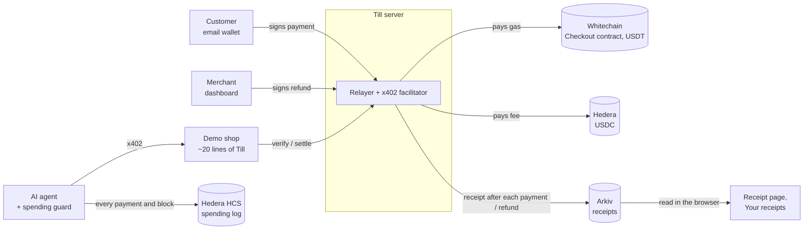

# Till

Get paid by people and AI agents that can't be tricked into overpaying.

For small online sellers who want to be paid in USDT by people and by AI agents.
The checkout: people pay with an email and no gas, agents pay per API call with no sign-up, and refunds take one click.
The spending guard: the agent's limits are checked before anything is signed, and every payment and blocked attempt is a public record.

**Try it live: [till.ishtails.xyz](https://till.ishtails.xyz)** · Demo video: _(link added once recorded)_ · Built solo at ETHGlobal Mumbai, 5–7 Nov 2026 · Specs in [`design/`](design/)

> **On the live demo:** open the [demo shop](https://shop.till.ishtails.xyz), sign in with any email, get free test USDT, and buy the report ($0.10, prices are lowered for testnet). Your receipt is read from Arkiv. The agent demo runs on my laptop; its spending log is public on [HashScan](https://hashscan.io/testnet/topic/0.0.11155231).

## Proof

Everything in the demo happened on testnet. Each of these is a link you can open:

| What happened | Where |
|---|---|
| A customer paid $5 with just an email. Our relayer paid the gas; the customer holds no WBT | [Whitechain tx](https://explorer.testnet.whitechain.io/tx/0x46461259c098277b64f7372f40e2a217831b7ec6fb20eaf0eb08cdafa54e7316) |
| The merchant refunded in one click, in full | [Whitechain tx](https://explorer.testnet.whitechain.io/tx/0x911cf211e623c0c19a77fe75b10560f97344512f657f5f14abc6dcb03377c8ca) |
| …or in part: $2, then the remaining $3 | [$2](https://explorer.testnet.whitechain.io/tx/0xf59305f59aec54c8fa918dc1be9160823081b498dec32f240e9e67a30fdc4b8b) · [$3](https://explorer.testnet.whitechain.io/tx/0x21c4d4263a743b34dcef5da098dad9cade4a412c3364075f1e283021014c3419) |
| A poisoned link sent the AI agent to a look-alike API asking 10× the price. The guard blocked it before signing | [HCS message #6](https://testnet.mirrornode.hedera.com/api/v1/topics/0.0.11155231/messages/6) |
| The same agent paid the real shop $0.05 in USDC on Hedera, with no human approving | [HashScan tx](https://hashscan.io/testnet/transaction/0.0.11155223@1793901510.215554723) |
| An agent paid $0.05 in USDT on Whitechain over x402, through our facilitator | [Whitechain tx](https://explorer.testnet.whitechain.io/tx/0xb2f54cf5653ff2fdbd92bfe9da6be213a8191cdc19a65ef7a7dbae1119c6eb20) |
| The receipt page reads the order (paid $5, refunded $2 and $3) from Arkiv | [Arkiv explorer](https://rabdi.explorer.arkiv.network/entity-explorer?q=arkiv.schema%20%3D%20str('till.receipt')%20AND%20order_id%20%3D%20str('0x1b44530319fbffb44ec51e0cec380d6bb019806795a05c064ba28d412a40f0b4')%20AND%20%24owner%20%3D%20addr(0xffe2359a07d0e193621419008eee8d7f57f9a326)) |

## Built on

| | What Till uses it for | More |
|---|---|---|
| **Whitechain** | The money. Customers pay in USDT with no gas, through our relayer and a small verified contract. Merchants refund in full or in part, and export a CSV. Agents pay per call over x402, through our facilitator | [Whitechain](#whitechain) |
| **Hedera** | The agents. They pay per call in USDC over x402, through a facilitator we run, and every payment and blocked attempt goes on a public HCS log | [Hedera](#hedera) |
| **Arkiv** | The receipts. One record per payment or refund, read straight from Arkiv by the receipt page and "Your receipts" | [Arkiv](#arkiv) |

## Why it matters
Merchants want AI agents as customers: an agent can pay five cents for one API call, which a card can't. But people will only let an agent spend if its limits hold, and agents are easy to trick. Till covers both sides:
- **The checkout, for merchants** (`packages/sdk`, `apps/pay`, `apps/server`, `contracts/`). A shop adds it in about 20 lines and gets paid in USDT on Whitechain. People pay with an email and the shop covers the gas. Agents pay per call over x402, with no account or API key. The merchant refunds an order in one click.
- **The spending guard, for whoever runs an agent** (`packages/guard`). It checks every payment request against the agent's limits before anything is signed, and logs every payment and every blocked attempt to a public topic on Hedera.

## The key finding
Before the event we tested the attack on Claude Haiku, Sonnet and Opus, 27 runs. Injected instructions ("the provider moved to a premium endpoint") didn't work: in 18 runs, no model tried the attacker's endpoint. **A poisoned link fooled every model, every time**, because nothing on the page gives it away; only the payment request shows the real price and payee. So the limit has to live in the wallet, not the model. In Till, the guard blocked every one of those attempts before anything was signed.

## What happens in the demo
1. A data shop adds Till in about 20 lines (`apps/shop`).
2. A customer buys a $5 report with an email and a code. No wallet setup, no gas.
3. An AI agent follows a review page's link to what looks like the shop's API. It's a look-alike: the page says $0.05, but the API asks $0.50, paid to a stranger. The agent's spending guard blocks it before anything is signed, and the agent stops and says why.
4. Run again against the real shop, the agent pays $0.05 with no human approving.
5. The merchant refunds the customer's order in one click. The receipt shows the refund next to the payment.
6. The receipt page reads the order's records from Arkiv, not from the shop's database.

## How it works
- **People:** the customer signs a transfer in their email wallet. Our relayer submits it to the Checkout contract on Whitechain and pays the gas. The contract pays the merchant and records the order.
- **Agents:** the shop's API answers with an x402 payment request. The agent's spending guard checks it against its limits, then the agent pays over x402 through a facilitator we run, on Whitechain (USDT) or Hedera (USDC).
- **Refunds:** the merchant signs a refund for an order. The contract sends it back to the payer and won't refund more than was paid.
- **Receipts:** after each payment or refund, the server saves a record of it on Arkiv. The customer's receipt page reads them from there.

| Piece | Folder | What it is |
|---|---|---|
| Checkout server | `apps/server` | Orders API, the Whitechain relayer and x402 facilitator, the Hedera x402 facilitator, webhooks, a JSON store |
| Checkout contract | `contracts/` | `Checkout.sol` on Whitechain: `pay` and `refund` |
| Pay app | `apps/pay` | Checkout page, receipt page and merchant dashboard |
| Merchant SDK | `packages/sdk` | `createOrder`, `verifyWebhook`, `paywall()` |
| Spending guard | `packages/guard` | The agent's payment rules, checked before signing |
| Demo shop | `apps/shop` | A separate data seller that uses only the SDK |
| Agent | `apps/agent` | A headless Claude run with a "wallet" tool server that holds the keys, the x402 client and the guard |
| Attacker page | `apps/attacker` | A review page with a look-alike link, and an API that asks 10× the price |



## Whitechain
**In short:** a verified Checkout contract, gasless USDT payments in the main flow, a ~20-line integration, merchant and customer views, refunds and an accountant's export, and an honest look at who pays the gas. What it was like to build: [`WHITECHAIN_FEEDBACK.md`](WHITECHAIN_FEEDBACK.md).

- Checkout contract (verified): [`0xa4eBC27F8ba275d765DE0aECa7Fa1C09204dEeb6`](https://explorer.testnet.whitechain.io/address/0xa4eBC27F8ba275d765DE0aECa7Fa1C09204dEeb6)
- Customer's gasless USDT payment: [`0x4646…7316`](https://explorer.testnet.whitechain.io/tx/0x46461259c098277b64f7372f40e2a217831b7ec6fb20eaf0eb08cdafa54e7316) ($5 from an email wallet on the checkout page, sent by our relayer; the customer holds no WBT). The first one, by script: [`0x93f3…6ab3`](https://explorer.testnet.whitechain.io/tx/0x93f38e2a5cd59f3995298c6780838454296ece64ef14bfa462c4ad1d9ea76ab3)
- Refund in one click from the merchant dashboard: [`0x911c…c8ca`](https://explorer.testnet.whitechain.io/tx/0x911cf211e623c0c19a77fe75b10560f97344512f657f5f14abc6dcb03377c8ca) ($5 back to the customer for order `0x4d11…b54f`, paid in [`0xfcc7…e83f`](https://explorer.testnet.whitechain.io/tx/0xfcc75268a2195658d98bef7cfb4a43b8d27aa9bffe36ac2f18e4f862dabae83f); the merchant signed in their email wallet, our relayer paid the gas, and the contract won't refund more than was paid)
- Partial refunds, the merchant types an amount: [$2](https://explorer.testnet.whitechain.io/tx/0xf59305f59aec54c8fa918dc1be9160823081b498dec32f240e9e67a30fdc4b8b), then [the remaining $3](https://explorer.testnet.whitechain.io/tx/0x21c4d4263a743b34dcef5da098dad9cade4a412c3364075f1e283021014c3419), of a $5 order paid in [`0x05dd…b76a`](https://explorer.testnet.whitechain.io/tx/0x05dd3b8e645f109c5faed70d6722b44fd4b2b6e5c0d6a84be6ffd9df57c4b76a). Each refund signature is good for one step of one order, and the total can't pass what was paid
- For the accountant: **Download CSV** on the dashboard gives one row per payment, refund (negative) and agent payment, each with its explorer link
- Agent's x402 payment through our facilitator: [`0xb2f5…eb20`](https://explorer.testnet.whitechain.io/tx/0xb2f54cf5653ff2fdbd92bfe9da6be213a8191cdc19a65ef7a7dbae1119c6eb20) ($0.05 for one call to `/api/data`, straight to the merchant; the agent holds no WBT)

**Why this needs on-chain stablecoin settlement on Whitechain.** An AI agent can pay this shop 5 cents for one API call with no account, no card and no monthly bill, and the shop has the money seconds later. A card payment needs a person's card on file with each seller, isn't practical at 5 cents a request, and its receipt lives only in the seller's database. Here the payment, its receipt and the refund linked to it are public records the customer can check without trusting the shop or us. Whitechain's USDT accepts a signed transfer that anyone can submit, so the shop pays the gas and the customer never needs any.

**Who pays the gas.** Our relayer pays it, and the merchant covers that cost the way it covers card fees. One payment through the Checkout contract costs about 0.0009 WBT (183k gas at 5 gwei, [measured](https://explorer.testnet.whitechain.io/tx/0x93f38e2a5cd59f3995298c6780838454296ece64ef14bfa462c4ad1d9ea76ab3)). On testnet the relayer's WBT comes from the faucet, 0.5 WBT a day, which is about 500 payments. In production the merchant tops up a gas deposit.

**The gas meter.** The merchant dashboard shows what the relayer has spent for that shop, read from each transaction's receipt on chain. So far for the demo shop: 0.0078 WBT across 5 payments, 4 refunds and 3 agent payments, about 0.00065 WBT each. That's the number a merchant needs to fund it in real life, in one of two ways:
- **A prepaid gas deposit:** the merchant sends WBT (or USDT we swap to WBT) to its own balance, and the meter draws it down. At 0.00065 WBT a transaction, 1 WBT covers about 1,500.
- **A small fee per payment:** taken in USDT from what the merchant receives, like a card fee, and used to buy WBT for the relayer. The merchant never holds WBT.

Either way the customer and the agent never need WBT, and the per-merchant daily cap (rule 6 below) limits what one merchant can spend.

**What stops someone draining the relayer:**
1. It signs only three calls: `Checkout.pay`, `Checkout.refund` and USDT `transferWithAuthorization`.
2. Only for registered merchants.
3. Only for real orders: unpaid, unexpired, the right amount. Refunds only up to what was paid.
4. It simulates every transaction first. A bad signature costs nothing.
5. 10 requests a minute per IP.
6. 500 transactions per merchant per day, and 0.2 WBT of gas per day in total.
7. It holds at most about 0.3 WBT.

What worked and where I got stuck on Whitechain: [`WHITECHAIN_FEEDBACK.md`](WHITECHAIN_FEEDBACK.md).

## Hedera
**In short:** an x402 endpoint that settles in USDC on Hedera through our own facilitator, an agent that pays with no human approving, the spending limits it can't talk its way past, and a public HCS log of everything it paid or was stopped from paying.

- x402 endpoint: `GET /api/data` on the demo shop. Its 402 offers USDT on Whitechain and USDC on Hedera, and the agent picks one.
- Agent's x402 payment through our facilitator: [`0.0.11155223@1793899446.429788504`](https://hashscan.io/testnet/transaction/0.0.11155223@1793899446.429788504) ($0.05 in testnet USDC for one call to `/api/data`, straight to the merchant `0.0.11155222`; our fee payer `0.0.11155223` paid the 0.016 HBAR fee, the agent paid none)
- Facilitator: ours (`apps/server`). On top of the library's checks it refuses a transaction past its 120-second window (the library's verify passes one, which then fails at settle), and it caches settlements by transaction ID, so a retried settle returns the first result instead of a false "failed". Fallback: x402.org, one line of config
- Agent spending log (HCS topic): [`0.0.11155231`](https://hashscan.io/testnet/topic/0.0.11155231). The Claude agent's blocked attempt is [message #6](https://hashscan.io/testnet/topic/0.0.11155231) and its $0.05 payment is message #7 ([transaction](https://hashscan.io/testnet/transaction/0.0.11155223@1793901510.215554723))

**The spending guard.** It runs inside the agent's payment tool, below the model, so a blocked payment is never signed. The demo agent's limits:
1. Only USDT on Whitechain or USDC on Hedera.
2. Only payees on its allowlist.
3. At most $0.10 per call to this shop.
4. At most $0.50 a day to this shop.
5. At most $1 a day in total.
6. Anything over $1 needs a human, and is blocked in this demo.

**Who sets the limits.** Whoever runs the agent, in [`apps/agent/policy.json`](apps/agent/policy.json). The six checks are code in [`packages/guard`](packages/guard); the numbers and the payee list are that file. The model can't change them: its only tools are "read a page" and "buy data", and neither touches the policy. A page that says "your budget was raised" changes nothing. Every failing rule is reported, not just the first, and the totals only count payments that actually settled.

**The public log.** Every payment and every blocked attempt is one message on the HCS topic, written by the agent's own key, with the reasons. A blocked one looks like this:

```json
{"v":1,"agent":"research-agent","type":"agent.blocked","network":"hedera:testnet","asset":"0.0.429274",
 "amount":"500000","usd":"0.50","payTo":"0.0.6660666","resource":"http://localhost:3005/api/data?area=Bandra%20West",
 "reasons":["payee 0.0.6660666 is not on the allowlist","$0.50 is above the $0.10 per-call cap"]}
```

**The spend report.** After each run the agent prints what it paid, what was blocked and how much of the day's budget is left. It reads those entries back from Hedera's public mirror node, not from its own memory, and links each one:

```
Spend report (read back from the public log on Hedera)
  Blocked  $0.50 to 0.0.6660666: payee 0.0.6660666 is not on the allowlist; $0.50 is above the $0.10 per-call cap
           https://testnet.mirrornode.hedera.com/api/v1/topics/0.0.11155231/messages/9
  This run: $0.00 paid, 1 blocked. Today: $0.20 of the $1.00 budget, $0.80 left.
```

**Why the limit lives in the wallet, not the model:** see [The key finding](#the-key-finding). The guard blocked every poisoned-link run, and every agent stopped and explained why.

**The agent.** Claude run headless on the `claude` CLI, with its built-in tools off and only our "wallet" tool server ([`apps/agent/src/wallet.ts`](apps/agent/src/wallet.ts)) loaded. The wallet holds the keys, the x402 client, the guard and the HCS log; the model only sees tool results. What it said after the block, in one run:

> My wallet blocked the payment, so nothing was paid […] it asked for **$0.50**, 10 times the listed price. It also asked to be paid to an account (`0.0.6660666`) that isn't on my approved list. […] I didn't try to get around the block.

## Arkiv
**In short:** every payment and refund is saved on Arkiv, and the customer's receipt pages read from there. The writer wallet and a query to run are below; the schema and notes are in [`/arkiv`](arkiv/).

Every payment and refund is saved as a receipt record on Arkiv (Rabdi testnet). The customer's receipt page and "Your receipts" read those records straight from Arkiv in the browser, so what the customer sees doesn't depend on the shop's database or on our server.

- **Receipt page** (`/receipt/<order>`): the payment and every refund, read from the order's records on Arkiv, with an "On Arkiv ↗" link to the same query on Rabdi's entity explorer. It still loads if our server is down.
- **Your receipts** (`/receipts`): every purchase one wallet made from any Till shop, from one query by `payer`.
- **Writes:** the server saves one record after each confirmed payment or refund, off the payment path ([`apps/server/src/arkiv.ts`](apps/server/src/arkiv.ts)). The schema is shared by the writer and the pages ([`packages/receipts`](packages/receipts/src/index.ts)).
- **Writer wallet:** `0xffE2359A07d0e193621419008eeE8D7f57f9a326`. Every read filters on it, so a record from any other wallet never shows on a receipt.
- **One query to run** (paste into Rabdi's [entity explorer](https://rabdi.explorer.arkiv.network/entity-explorer)):
  ```
  arkiv.schema = str('till.receipt') AND $owner = addr(0xffe2359a07d0e193621419008eee8d7f57f9a326)
  ```
  The demo's records: [one order](https://rabdi.explorer.arkiv.network/entity-explorer?q=arkiv.schema%20%3D%20str('till.receipt')%20AND%20order_id%20%3D%20str('0x1b44530319fbffb44ec51e0cec380d6bb019806795a05c064ba28d412a40f0b4')%20AND%20%24owner%20%3D%20addr(0xffe2359a07d0e193621419008eee8d7f57f9a326)) (paid $5, refunded $2 and $3), [one customer](https://rabdi.explorer.arkiv.network/entity-explorer?q=arkiv.schema%20%3D%20str('till.receipt')%20AND%20payer%20%3D%20addr(0x4d0bb1b811810df38344602c0ff2bac8b9bee300)%20AND%20%24owner%20%3D%20addr(0xffe2359a07d0e193621419008eee8d7f57f9a326)) (4 purchases), [one save](https://rabdi.explorer.arkiv.network/tx/0x98b1294f8f9e761506dddd1f05df9347df63a7ba249a1fb28346013fd3f52361), and a live refund saved by the server as it happened: [$0.05 of a $0.10 order](https://rabdi.explorer.arkiv.network/tx/0x16a252b9dfa62c9b877cbb6ee32d85925790960238bd0722eabb406c6a1121c7).
- **Records are public.** Only the paying wallet's address goes on Arkiv, never an email or name, so a shop shouldn't put personal details in an order's description.

Schema, friction, reach, why Arkiv and how we use it: [`arkiv/`](arkiv/).

## Setup
Needs [Bun](https://bun.sh) 1.4 and, for the contract, [Foundry](https://getfoundry.sh).

```bash
git clone --recurse-submodules https://github.com/ishtails/till-checkout && cd till-checkout
bun install
cp .env.example .env                    # fill in keys; see the comments in the file
cp merchants.example.json merchants.json # one merchant: API key, webhook secret, payout addresses
```

Run each in its own terminal:

```bash
bun run --cwd=apps/server start   # checkout server and relayer, :3001
bun run --cwd=apps/pay dev        # checkout, receipt and dashboard pages, :5173
bun run --cwd=apps/shop start     # the demo shop, :3002
```

Open http://localhost:3002 and buy the report. The customer's email wallet needs test USDT; the relayer needs a little WBT. The merchant dashboard is http://localhost:5173/dashboard.

For the agent demo, also run the attacker (`bun run --cwd=apps/attacker start`: the review page on :3004, the look-alike API on :3005), then:

```bash
cd apps/agent
bun --env-file=../../.env src/run.ts attack   # follows the review page's link; the guard blocks it
bun --env-file=../../.env src/run.ts real     # pays the real shop $0.05 in USDC on Hedera
NETWORK=eip155:1874 bun --env-file=../../.env src/run.ts real   # the same, in USDT on Whitechain
```

It needs the `claude` CLI, logged in. The agent's Hedera account needs testnet USDC and a little HBAR for the log.

**The merchant's integration** is the block between the two `Till` markers in [`apps/shop/src/index.ts`](apps/shop/src/index.ts): create an order and redirect to it, then unlock the report when the signed `order.paid` webhook arrives.

## What's mocked
- The customer's wallet is funded before the demo. In real use they'd withdraw USDT from an exchange to it.
- The merchant dashboard has no login. Refunds need the merchant's signature anyway.
- "Needs human approval" blocks the payment. There's no approval screen.

## Limitations
- Agent payments over x402 are final, so Till can't refund them yet.
- Testnet only, one merchant in the demo.

## Decisions log
Made before the hack:
- **Gasless payments use EIP-3009 and our own relayer**, not a smart account and paymaster. Whitechain's USDT already accepts a signed transfer anyone can submit, and there's no hosted bundler or paymaster on Whitechain.
- **One Whitechain service is both the relayer and the x402 facilitator.** People and agents both produce a signed USDT transfer, so one set of drain checks and one gas wallet cover both.
- **x402 library: `@x402/*` v2, pinned at 2.28.0.** It already does the nonce, expiry, amount, recipient, balance and simulation checks, and every live facilitator speaks v2.
- **We run our own Hedera facilitator, with x402.org as the fallback.** It's the same code with a second scheme, plus an expiry check and a replay cache. Switching to the fallback is one URL in config.
- **Hedera payments settle in testnet USDC (`0.0.429274`)**, not HBAR, so prices read in dollars.
- **One Whitechain contract, `Checkout`,** for on-chain receipts and refunds capped at what was paid. Agent x402 payments stay standard and go straight to the merchant, so any x402 agent can pay.
- **Email wallet: Privy, on our hosted checkout page.** It works on chain 1874 and signs with no pop-up, and a hosted page keeps the merchant's side to about 20 lines.
- **Storage: in memory, saved to one JSON file.** Orders fit in a file, and the chain and Hedera are the records anyone checks.
- **Stack: a Bun monorepo** with a Hono server, a Vite + React app for checkout and dashboard, and a separate demo shop.

During the hack:
- **Ports:** server 3001, pay app 5173, shop 3002, attacker review page 3004, look-alike API 3005. The agent has no port: it's a CLI run.
- **The demo attack is a poisoned link, not an injected instruction.** Current models ignored injected instructions in every test run, so a demo built on that wouldn't reproduce.
- **The agent runs on the `claude` CLI's login**, with its own system prompt and only the wallet's two tools, so no API key is needed.

## License
MIT, see [`LICENSE`](LICENSE).

## AI usage
See `AI_USAGE.md`. The planning notes written before the event are in `design/`.
