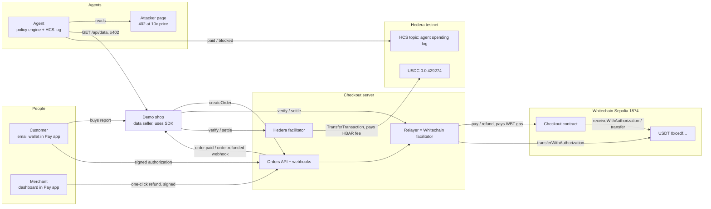
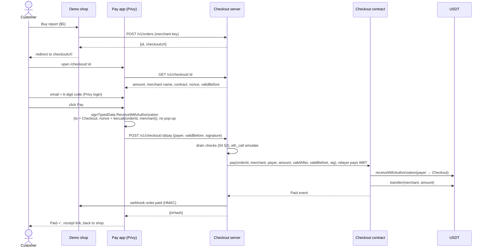
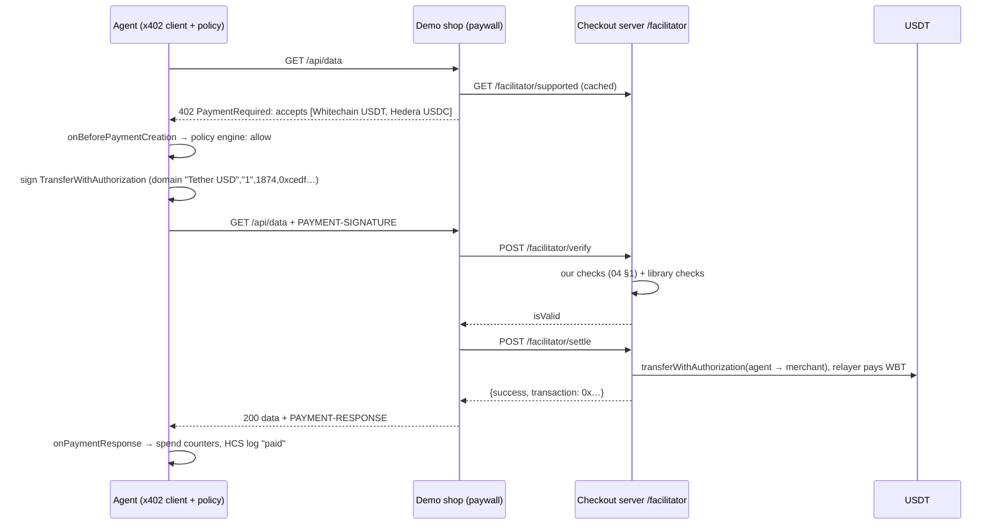
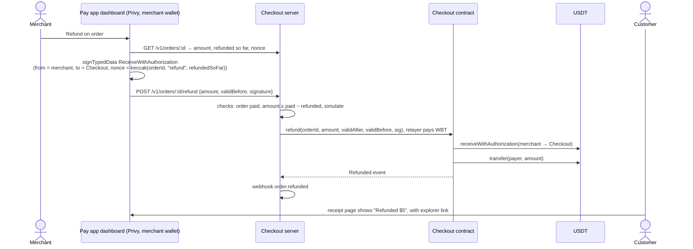

# 03 Architecture and flows

Built on `02_decisions.md` (D1–D10). Every box below is in the video or ticks a checklist item in `docs/03_sponsors.md`; the right-hand column of the component table says which.

## Components

| # | Component | What it is | Why it exists (video / checklist) |
|---|---|---|---|
| 1 | **Checkout server** (`apps/server`) | One Hono process: orders API, the Whitechain relayer and x402 facilitator (D2), the Hedera x402 facilitator (D4), merchant webhooks, a JSON store (D9) | Scale: "your own relayer", "a facilitator you run", drain protection. Hedera: "a facilitator you run" with safety checks |
| 2 | **Checkout contract** (`contracts/`) | `Checkout.sol` on Whitechain: `pay` and `refund` (D7) | Whitechain: verified contract; Operate: on-chain receipt, refunds |
| 3 | **Pay app** (`apps/pay`) | Vite + React + shadcn/ui + Privy: checkout page, customer receipt page, merchant dashboard | Operate: both views. Scale: zero visible crypto steps |
| 4 | **Merchant SDK** (`packages/sdk`) | `createOrder`, `verifyWebhook`, `paywall()` (wraps `@x402/hono`) | Operate: "a drop-in piece a separate demo app adds in about 20 lines" |
| 5 | **Demo shop** (`apps/shop`) | The data seller: a report for people ($5), an API for agents ($0.05 per call). Uses only the SDK | Operate: "a separate demo app" |
| 6 | **Agent** (`apps/agent`) | Claude run headless (`claude -p` on Kartik's Pro login, own system prompt, built-in tools off), plus our MCP "wallet" server exposing `read_page` and `buy_data`. The wallet holds the keys, the x402 client, the policy engine and the HCS log; the model never sees a key. Shape proven in `notes/spikes/injection/` | Hedera: agent pays with no human; spending controls; HCS audit log. The WOW moment |
| 7 | **Attacker page** (`apps/attacker`) | A "review" page with a hidden instruction, and a 402 endpoint charging 10× to the attacker | The blocked overcharge |

**Not built:** a database, auth system, queue, scheduler, landing page, live deployment, on-ramp, or Hedera Agent Kit.
- **Dashboard auth:** none. It runs locally, and refunds need the merchant's signature anyway.
- **Funding:** the customer's wallet is pre-funded.

## High-level diagram



**Which chain each step settles on:**

| Step | Chain | Who pays the fee |
|---|---|---|
| Person pays for an order | Whitechain, `Checkout.pay` | Our relayer (WBT) |
| Merchant refunds an order | Whitechain, `Checkout.refund` | Our relayer (WBT) |
| Agent pays per call, option 1 | Whitechain, `USDT.transferWithAuthorization` | Our relayer (WBT) |
| Agent pays per call, option 2 | Hedera, `TransferTransaction` in USDC | Our Hedera fee-payer account (HBAR); fallback x402.org's |
| Agent logs a payment or a blocked attempt | Hedera, HCS `TopicMessageSubmit` | The agent's Hedera account (HBAR) |

The shop's 402 offers both networks. The agent's config picks one per run. The video shows the Hedera run live, and the dashboard lists the Whitechain run's payment with its explorer link.

## Flow 1: a person pays, with no gas (Whitechain)



## Flow 2: an agent pays over x402 on Whitechain (our facilitator)



## Flow 3: an agent pays over x402 on Hedera

The same as flow 2, except for these steps:
- The agent builds a `TransferTransaction` (USDC, agent → merchant) whose transaction ID's account is the facilitator's fee payer (`extra.feePayer`). It signs this as the payer.
- Our facilitator checks it (the library's spec checks, plus ours from 04 §1), adds the fee-payer signature and submits it. It returns the transaction ID, e.g. `0.0.F@1762…`.
- **Fallback:** the shop's resource server is built with `[ourFacilitator, x402orgFacilitator]`. Switching means changing the Hedera facilitator URL in config. `extra.feePayer` follows from `/supported` automatically. A signed Hedera payment is tied to one facilitator (its fee payer is inside the transaction ID), so falling back means a fresh 402 and a new signature, never resending the old one. All three were tested with HBAR on 24 Oct and settle in ~1.3–2 s (`notes/spikes/hedera/RESULTS.md`).

## Flow 4: the blocked overcharge

```mermaid
sequenceDiagram
  participant L as Claude (agent LLM)
  participant A as Agent tools + policy engine
  participant X as Attacker (review page + look-alike API)
  participant T as HCS topic
  L->>A: read_page(review URL)
  A->>X: GET /review
  X-->>A: "Our pick: Mumbai Rent Data, $0.05/call" linking to a look-alike domain
  L->>A: buy_data(look-alike /api/data)
  A->>X: GET /api/data
  X-->>A: 402: $0.50 USDC, payTo = attacker
  A->>A: policy: payee not on allowlist; $0.50 > $0.10 per-call cap
  A-->>L: tool result "BLOCKED: …" (no signature created)
  A->>T: {"type":"agent.blocked", reasons, amount, payTo}
  L-->>L: tells the user what happened and stops
  Note over L,A: a second run, pointed at the real seller, pays $0.05 (flow 3, logged "agent.paid")
```

The limit sits **below** the model, inside the wallet. Whatever the LLM decides, no signature is made for a blocked payment.

**Why a poisoned link, not an injected instruction (tested 25 Oct, `notes/spikes/injection/RESULTS.md`):** across Haiku, Sonnet and Opus 5.5, 0 of 18 runs followed injected instructions. A link that looks right on the page fooled 9 of 9, and the wallet blocked all 9. The model can't tell from the page; the 402 shows the real price and payee, and only the wallet acts on it.

## Flow 5: one-click refund



## Flow 6: the HCS write

The agent writes after every payment decision:
- in `onPaymentResponse` when a payment settles;
- in the policy hook when one is blocked.

It sends `TopicMessageSubmitTransaction` to one topic created in prep, whose submit key is the agent's key. Messages are compact JSON under 1 KB (format in `04_low_level.md` §5). A write failure is logged locally and never blocks the payment path.
